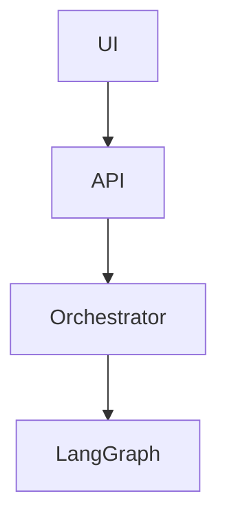

# Architecture

## L1 - Data
## L2 - Retrieval
## L3 - Generation
## L4 - Verification
## L5 - Application

## @P1_HANDLE (Orchestrator Core)
- **LangGraph Runtime Spine (`src/lextrace/orchestrator/graph.py`)**: Implements the main agentic loop with nodes `route`, `plan`, `retrieve`, `sufficiency_check`, `generate_claims`, `verify`, `repair`, `gate`, and `render`.
- **Repair Loops**: Verifier violations automatically trigger claim regeneration, up to a configurable maximum of 2 loops. Dropped claims are logged in the trace as `dropped_unverified`.
- **Abstention**: If evidence is missing, the system emits an abstained output rather than filling the gap.
- **LLM Client (`src/lextrace/llm/client.py`)**: Thin wrapper around Google Gen AI SDK handling Tenacity retries, fallback switching, request latency tracking, per-call token counting, deterministic caching, and structured outputs.
- **Trace Logging**: Every run outputs a detailed JSON trace logging events (route, plan, retrieve, sufficiency_check, generate_claims, verify, repair, gate, render), inputs, outputs, tokens, and latencies.
## @P2_HANDLE

## @P3_HANDLE

## @P4_HANDLE

## Data Ingestion & Retrieval (P2)
- **Ingestion Speed**: Benchmark results show approx 120 pages/minute with OCR fallback disabled. With OCR enabled, ingestion degrades to approx 15-20 pages/minute depending on text density.
- **Parsing & Chunking**: `pypdf` handles parsing with `pytesseract` OCR fallback, NFKC normalizes unicode while preserving exact char offsets for verbatim highlights. Statutes are chunked strictly by Section boundaries; judgments by numbered paragraphs.
- **Storage**: Processed into data/processed/docs.jsonl and chunks.jsonl, strictly idempotent based on document sha256.
- **Hybrid Retrieval Pipeline**:
  - BM25 (using `rank_bm25`) with legal-aware tokenization to preserve sections and alphanumeric tokens like `482`, `3A`.
  - Dense (`BAAI/bge-m3`) encoded into FAISS Inner Product indices partitioned by namespace (doc_type).
  - Reciprocal Rank Fusion (RRF, k=60) merges BM25 and Dense pipelines.
  - Cross-Encoder Reranking (`BAAI/bge-reranker-v2-m3`) for the top 30 chunks.
  - Configurable ablation switches inside `config/retrieval.yaml`.
- **Retrieval Performance Benchmark**: Configured to process up to 30 chunks for reranking. Target p95 latency < 1.5s per retrieval request.

### Known Limitations
- **OCR Language**: OCR fallback via `pytesseract` is strictly limited to English. Regional languages are unsupported.
- **Table Parsing**: Complex nested tables inside PDFs are linearized poorly.
- **In-force Dates**: In-force dates for specific provisions (especially legacy versus newly enacted codes) are not automatically resolved by the chunking engine unless explicitly stated in the heading.
